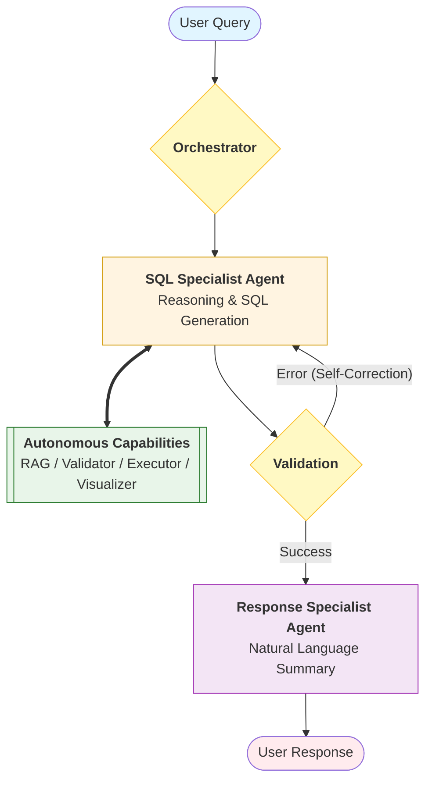

# ChatDB - Production-Ready Agentic SQL Assistant

A production-grade SQL assistant built with **LangGraph** that enables non-technical users to query databases using natural language. The system uses multi-agent orchestration, RAG for semantic schema matching, and a multi-layer validation pipeline.

## 🚀 Features

- **Natural Language to SQL**: Convert plain English queries to SQL
- **Multi-Agent Orchestration**: LangGraph-based workflow with intelligent routing
- **RAG-Powered Schema Discovery**: Semantic search for relevant tables and columns
- **Multi-Layer Validation**: Syntax and schema validation before execution
- **Streaming Responses**: Real-time WebSocket streaming for better UX
- **Production-Ready**: Error handling, retry logic, and observability support

## 🏗️ Architecture

### System Architecture

```
┌─────────────┐
│   Frontend  │ (Next.js + TypeScript)
│  (WebSocket)│
└──────┬──────┘
       │
       ▼
┌─────────────┐
│   FastAPI   │ (REST + WebSocket)
└──────┬──────┘
       │
       ▼
┌─────────────┐
│  LangGraph  │ (Agent Orchestration)
└──────┬──────┘
       │
       ├──► Database Tools (Introspection)
       ├──► RAG (Schema Search)
       ├──► Validation (Syntax + Schema)
       └──► Execution (Query Runner)
```

### Agent Workflow

The system uses a multi-agent orchestration pattern powered by LangGraph, implementing an autonomous loop from natural language to validated insights:



## 📋 Prerequisites

- Python 3.11+
- Node.js 18+ (for frontend)
- OpenRouter API key (or OpenAI API key)

## 🛠️ Installation

### Backend Setup

1. **Navigate to backend directory:**
   ```bash
   cd backend
   ```

2. **Create virtual environment:**
   ```bash
   python -m venv venv
   source venv/bin/activate  # On Windows: venv\Scripts\activate
   ```

3. **Install dependencies:**
   ```bash
   pip install -r requirements.txt
   ```

4. **Create `.env` file:**
   ```bash
   cp .env.example .env
   ```

5. **Configure environment variables:**
   ```env
   OPENROUTER_API_KEY=sk-or-v1-your-key-here
   OPENROUTER_MODEL=kwaipilot/kat-coder-pro:free
   DATABASE_URL=sqlite:///./demo_database.db
   ```

6. **Create sample database:**
   ```bash
   python -m backend.database.sample_data
   ```

7. **Start the backend server:**
   ```bash
   python -m backend.main
   # Or
   uvicorn backend.api.main:app --reload
   ```

### Frontend Setup

1. **Navigate to frontend directory:**
   ```bash
   cd frontend
   ```

2. **Install dependencies:**
   ```bash
   npm install
   ```

3. **Update `config.ts` if needed:**
   ```typescript
   backendUrl: process.env.NEXT_PUBLIC_BACKEND_URL || 'http://localhost:8000'
   ```

4. **Start the development server:**
   ```bash
   npm run dev
   ```

5. **Open your browser:**
   ```
   http://localhost:3000
   ```

## 📁 Project Structure

```
chatdb/
├── backend/
│   ├── agent/              # LangGraph agent workflow
│   │   ├── graph.py        # Graph construction
│   │   ├── nodes.py        # Agent nodes
│   │   ├── routers.py      # Conditional routing
│   │   ├── state.py        # State schema
│   │   └── prompts.py      # System prompts
│   ├── tools/              # Agent tools
│   │   ├── database.py     # Database introspection
│   │   ├── rag.py          # RAG for schema search
│   │   ├── validation.py   # SQL validation
│   │   └── execution.py    # Query execution
│   ├── database/           # Database management
│   │   ├── connection.py  # Connection manager
│   │   └── sample_data.py  # Sample database
│   ├── api/                # FastAPI endpoints
│   │   └── main.py         # WebSocket + REST API
│   └── config/             # Configuration
│       └── settings.py     # Settings management
├── frontend/               # Next.js frontend
│   ├── app/                # Next.js app directory
│   ├── components/         # React components
│   ├── hooks/              # Custom hooks
│   └── contexts/           # React contexts
└── README.md
```

## 🔧 Configuration

### Environment Variables

**Backend (`.env`):**
- `OPENROUTER_API_KEY`: Your OpenRouter API key
- `OPENROUTER_MODEL`: Model to use (default: `openai/gpt-4o-mini`)
- `DATABASE_URL`: Database connection string
- `LANGCHAIN_TRACING_V2`: Enable LangSmith tracing (optional)
- `LANGCHAIN_API_KEY`: LangSmith API key (optional)

**Frontend (`config.ts`):**
- `NEXT_PUBLIC_BACKEND_URL`: Backend API URL (default: `http://localhost:8000`)

## 🎯 Usage

### Basic Query

1. Start the backend and frontend servers
2. Open the web interface
3. Type a natural language query:
   ```
   Show me all customers from the last month
   ```
4. The agent will:
   - Search for relevant tables
   - Get table schemas
   - Generate SQL
   - Validate the query
   - Execute and return results

### Example Queries

- "Show me all orders with amount greater than 100"
- "List customers who have placed more than 3 orders"
- "What's the total revenue by product category?"
- "Find the top 5 customers by order amount"

## 🧪 Testing

```bash
# Backend tests
cd backend && pytest tests/

# Test REST API
curl -X POST http://localhost:8000/api/query \
  -H "Content-Type: application/json" \
  -d '{"message": "show me all customers"}'
```

## 🔍 Observability

Enable LangSmith tracing (optional):

```env
LANGCHAIN_TRACING_V2=true
LANGCHAIN_API_KEY=your-langsmith-key
```

## 📚 API

### FastAPI Docs (Browse All Endpoints)

- **Swagger UI**: `http://localhost:8000/docs`
- **ReDoc**: `http://localhost:8000/redoc`
- **OpenAPI JSON**: `http://localhost:8000/openapi.json`

**WebSocket:** `ws://localhost:8000/ws/chat`

**REST:** `POST /api/query`
```json
{"message": "show me all customers", "thread_id": "optional"}
```

## 🔐 Security & Error Handling

- **Read-Only Queries**: Only SELECT queries allowed
- **Multi-Layer Validation**: Syntax and schema validation
- **Error Recovery**: Automatic retry with limit (max 3 errors, 10 tool rounds)
- **SQL Injection Protection**: Parameterized queries

## 📝 License

MIT License

## 🙏 Acknowledgments

Built with [LangGraph](https://github.com/langchain-ai/langgraph), powered by [OpenRouter](https://openrouter.ai/), frontend with [Next.js](https://nextjs.org/)
